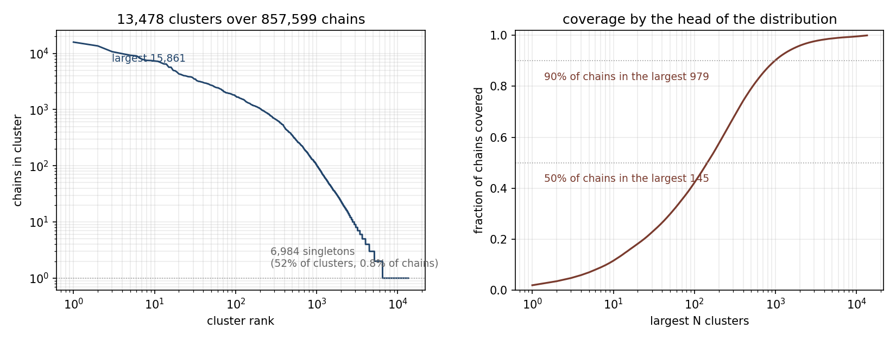

# Phase 3 report: structural clustering of the val-side chains

Run `i-0ef9e10000084db14` (c7i.2xlarge, us-west-2a), launched 2026-09-11T00:12:47Z,
`_DONE_rc0` at 01:51:18Z. 1.64 hours end to end, about $0.58. Artifacts at
`s3://marinfold-exp91-usw2/exp145/cluster-output/` and, apart from the 61 KB log,
mirrored into `data/curation/`.

One `foldseek easy-cluster` (commit `463739e0`) over every distinct val-side chain,
TM-score >= 0.5, coverage 0.5, 8 threads.

| stage | result |
|---|---|
| extract | 857,599 chains, 45,294,441,724 bytes, 51.6 kB mean, 441 tar shards, 2,227.6 s (37.1 min) on 8 workers |
| cluster | 13,478 clusters, 3,478.0 s (58.0 min), 4.12 GB peak RSS |

## The distribution



857,599 chains fall into **13,478 clusters**, a representative fraction of **1.57%**.
The pilot on 3,376 chains gave 21.1%, and this plan guessed the full set would land
somewhere between 15,000 and 150,000 clusters. It came in under that range, so the
corpus is more structurally redundant than any extrapolation from one AFDB ID band
suggested.

The distribution is head-heavy at both ends at once:

| | clusters | chains |
|---|---|---|
| largest cluster | 1 | 15,861 (1.85%) |
| largest 145 | 1.1% | 50% |
| largest 979 | 7.3% | 90% |
| 100 or more members | 1,011 | 775,248 (90.4%) |
| singletons | 6,984 (51.8%) | 6,984 (0.81%) |

Half of all clusters are singletons and together they account for eight chains in a
thousand. The mean cluster holds 63.6 chains and the median holds 1. A draw of one
complex per cluster is therefore nothing like a draw of one complex per thousand
chains: it upweights the 6,984 singletons by three orders of magnitude relative to
the 145 clusters that are half the corpus, which is the intended behaviour for a
validation set and worth stating explicitly before phase 5 acts on it.

**The head is not a short-chain artifact.** Median chain length across the whole set
is 391 residues; across the 145 clusters that cover half the chains it is 418, and
across singletons 381. The top ten clusters have median lengths from 224 to 685
residues (`data/curation/mmseqs_work/subunits.fasta` joined against the cluster
map). Foldseek is not collapsing short peptides that happen to align; these are
ordinary-length chains that genuinely share a fold. The largest cluster,
representative `A0A0D2H3B7`, holds 15,861 chains of median length 302.

## What this means for the validation set

Phase 4 labels each complex `cluster_{min}_{max}` from its two chains. Running that
labeling now, over 881,010 val complexes with the 762 unfetchable models excluded:

| | count |
|---|---|
| complexes labeled | 880,247 |
| homodimers among them | 824,125 (93.6%) |
| **distinct cluster pairs** | **17,083** |
| pairs whose two clusters are the same | 10,151 |
| pairs seen in exactly one complex | 8,621 |
| largest pair | 15,846 complexes |
| pairs covering 50% of complexes | 154 |

**17,083 is the ceiling on the val set** under one complex per cluster pair, before
the 7-residue interface filter and any confidence gate cut into it. 8,621 of those
pairs (50.5%) occur exactly once, so for half the draw there is no choice of
representative to make and no filter slack: if that single complex fails the
interface filter, the pair drops out. Phase 5 should expect the realized set to be
meaningfully below 17,083 and should report how many pairs it loses that way.

Only 6,932 pairs join two different clusters. The set is dominated by homodimers
(93.6%), which is inherited from the AFDB release, not from anything this phase did.

## The one chain that is missing

`chains_absent.csv` holds a single row, `A0A3Q1MTM2,AF-0000000208803286,A`, against
857,600 expected. `AF-0000000208803286` is the only model id that appears twice in
the val assignment, as the homodimer `A0A3Q1MTM2/A0A3Q1MTM2` and as the heterodimer
`A0A044RNL9/A0A044S3F6`. `curate_extract_chains.py` inverted its accession-to-source
map with `by_model[model][chain] = accession`, so the heterodimer's chain A
overwrote the homodimer's and that accession was never requested. The same duplicate
explains the 881,010-row / 881,009-distinct-model discrepancy and the duplicate row
in `fetch_timings.csv.gz`.

`by_model` now holds a list of `(chain, accession)` pairs and reproduces all 857,600
from the same assignment. The published clustering was not regenerated: one chain in
857,599 cannot move 13,478 clusters, and a rerun costs 1.6 hours and $0.58. The
labeling above counts it as the one `n_unmapped_chain`, and it is excluded
downstream alongside the 762 unfetchable models.

## Artifacts

| file | what it is |
|---|---|
| `data/curation/chain_cluster.tsv.gz` | 4.4 MB, 857,599 rows, representative to member |
| `data/curation/chain_cluster_summary.json` | every number quoted above |
| `data/curation/chain_cluster_sizes.csv` | 728 rows, one per distinct cluster size |
| `data/curation/chain_cluster_pair_sizes.csv` | the same for cluster pairs over complexes |
| `data/curation/chain_cluster_largest.csv` | the 25 largest clusters by representative |
| `data/curation/chain_cluster_sizes.png` | the figure above |
| `data/curation/chains_summary.json` | the extraction stage |
| `data/curation/foldseek_scaling_full.json` | the clustering stage, in the same schema as the pilot sweeps |
| `data/curation/chains_absent.csv` | the one absent accession |

Regenerate the derived files with:

```
python3 curate_cluster_report.py --tsv data/curation/chain_cluster.tsv.gz \
    --out data/curation --top 25 \
    --assignment data/curation/dimer_split_assignment_id30_cov50.csv.gz \
    --missing data/curation/fetch_missing_404.csv
python3 plot_cluster_sizes.py
```
