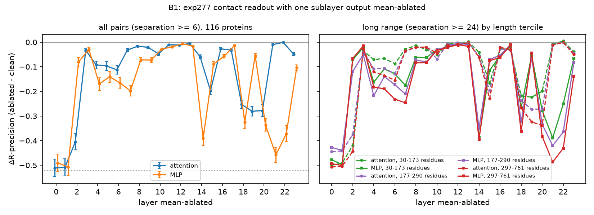

# exp341 B1: layer ablation of the contact readout

B1 of [\#341](https://github.com/Open-Athena/MarinFold/issues/341) asks
where in exp277's 24 layers the contact prediction is computed, to inform
decision B in [`research_plan.md`](research_plan.md) (section 1.2): whether
the next size sweep should favour depth or width. This report covers the
layer ablation. The tuned lens, the other half of B1, has not been run.

**Recommendation: do not make the next model shallower or move parameters
from depth into width. If a size sweep runs, run its deeper arm first.**
The ablation does not show that a deeper model would predict contacts
better; only that sweep can show that.

Decision B's two depth rows, with the plan's layer numbers (1 to 24; this
report's layers are 0 to 23, so the plan's layers 19 to 24 are 18 to 23
here):

| Plan's condition | "Favour depth" row | "Favour width or shallower" row | Observed |
|---|---|---|---|
| Mean-ablating one late layer (19 to 24) costs | >= 0.02 R-precision | < 0.01 | Every late MLP costs 0.054 to 0.458; late attention 0.001 to 0.281 |
| Tuned-lens readout over layers 19 to 24 | still rising by >= 0.03 | within 0.01 of final by layer 18 | Not run |

The ablation half of the "width or shallower" row fails by a wide margin:
no late MLP costs less than 0.05. The ablation half of the "depth" row
holds. The plan proposed these thresholds before the run and treats them as
provisional; the conclusion does not depend on them, since the late MLP
costs are 5 to 46 times the 0.01 boundary.

Three reasons the result points at the deeper arm without proving a deeper
model is better:

- **A costly late layer shows the model uses its depth, not that it lacks
  depth.** A model with exactly enough layers and a model that needs more
  would both show costly late layers. Ablating layer 0 or layer 1 costs as
  much as ablating layer 21, and that does not argue for more early layers.
  The ablation could have ruled depth out (cheap late layers) and did not.
- **Some layers are lightly used.** Layers 11 to 13 each cost under 0.02 for
  both sublayers, and the attention in layers 21 and 22 costs 0.010 and
  0.001. A single-layer ablation misses work that two layers share, so
  these are upper bounds on spare capacity, not measurements of it.
- **The late MLPs matter more on long proteins.** For long-range contacts,
  ablating the layer 22 MLP costs 0.25 on 30-173-residue proteins and 0.43
  on 297-761-residue proteins. Long proteins are where contacts-v1 scales
  worst (\#262, L^0.79), and B2 found the contact budget is not the cause
  (229 of 69.5M training documents truncated). Late computation is a
  candidate, and a deeper model is one way to add it.

Two cheaper results would firm this up before training anything: the tuned
lens (under 1 GPU-hour in the plan's estimate), which fills the other half
of the decision-B rule, and the same ablation on an earlier exp277
checkpoint, which separates late layers still being trained from late
layers that have converged.

## What ran

| Item | Value |
|---|---|
| Model | `contacts-v1-exp277-m2-p06-full-epoch-1.5B` (step 266344), bf16 |
| Proteins | 116: eval-val (97) and eval-denovo (19) |
| Readout | production pairwise P(contact), 4 document seeds per protein |
| Conditions | clean, plus 24 layers x {attention, MLP} each mean-ablated alone |
| Compute | one NVIDIA L4 (g6.xlarge, us-east-2), 4.25 GPU-hours, about 320 s per condition |
| Run | `s3://marinfold-exp91-usw2/exp341/b1/20261017T142617Z-9a5b6aa0/`, commit 9a5b6aa0 |

Mean ablation replaces the sublayer's output, before it is added to the
residual stream, with one fixed vector at every position. Each vector is
the mean of that sublayer's output over all 710,640 positions the clean
readout processes (sequence-section and contact-query positions, across all
proteins and seeds). The ablated runs reuse the clean run's proteins and
document seeds, so each comparison is paired.

R-precision is scored on the seed-averaged matrix, as in production, for
all pairs (separation >= 6) and three bands: short (6-11), medium (12-23)
and long (>= 24). The clean model scores 0.522 on all pairs (0.566 short,
0.537 medium, 0.498 long). An ablation that removes all contact signal
lands near -0.52.

## Results

Change in all-pairs R-precision (ablated minus clean), 116 proteins, 95%
bootstrap CI over proteins:

| Layer | Attention | MLP |
|---|---|---|
| 0 | -0.511 | -0.490 |
| 1 | -0.509 | -0.507 |
| 2 | -0.405 | -0.081 |
| 3 | -0.033 | -0.029 |
| 4 | -0.092 | -0.170 |
| 5 | -0.097 | -0.140 |
| 6 | -0.113 | -0.165 |
| 7 | -0.032 | -0.198 |
| 8 | -0.016 | -0.072 |
| 9 | -0.021 | -0.073 |
| 10 | -0.047 | -0.029 |
| 11 | -0.010 | -0.019 |
| 12 | -0.012 | -0.006 |
| 13 | -0.005 | -0.016 |
| 14 | -0.059 | -0.390 |
| 15 | -0.197 | -0.089 |
| 16 | -0.027 | -0.057 |
| 17 | -0.032 | -0.014 |
| 18 | -0.253 (-0.270, -0.236) | -0.325 (-0.350, -0.300) |
| 19 | -0.281 (-0.301, -0.261) | -0.054 (-0.062, -0.046) |
| 20 | -0.278 (-0.302, -0.254) | -0.337 (-0.362, -0.311) |
| 21 | -0.010 (-0.013, -0.007) | -0.458 (-0.490, -0.427) |
| 22 | -0.001 (-0.003, +0.002) | -0.372 (-0.404, -0.338) |
| 23 | -0.049 (-0.054, -0.043) | -0.104 (-0.114, -0.093) |

Layers 0 and 1 (both sublayers) and the layer 21 MLP leave almost no
contact signal. The costly sublayers fall in three groups: layers 0 to 2,
layers 14 and 15, and layers 18 to 22, with layers 11 to 13 the cheapest
stretch between them.

**Statistics.** 47 of the 48 conditions have a CI that excludes zero; the
exception is layer 22 attention. The median CI half-width is 0.010 when
bootstrapping proteins and 0.014 when also resampling the 4 document seeds
within each protein. The second CI is centred on the mean per-seed change,
which differs from the seed-averaged change by up to 0.09 (layer 15 MLP:
-0.182 per seed, -0.089 averaged), because R-precision of an averaged
matrix is not the average of per-seed R-precisions. Effects this large do
not need repeat runs; a run with `--seed-offset 4` would tighten the
seed-level CI if small effects become the question.

**Separation bands.** The four bands give similar changes for most
sublayers. The late MLPs are the exception: the layer 22 MLP costs 0.349 on
long-range pairs and 0.217 on short-range pairs, and the layer 21 MLP 0.432
against 0.351.

**Length.** Long-range change by length tercile (39, 38 and 39 proteins):

| Sublayer | 30-173 residues | 177-290 | 297-761 |
|---|---|---|---|
| Layer 18 MLP | -0.267 | -0.324 | -0.363 |
| Layer 20 MLP | -0.278 | -0.334 | -0.383 |
| Layer 21 MLP | -0.389 | -0.420 | -0.487 |
| Layer 22 MLP | -0.251 | -0.365 | -0.431 |
| Layer 23 MLP | -0.066 | -0.083 | -0.139 |
| Layer 19 attention | -0.224 | -0.273 | -0.324 |
| Layer 20 attention | -0.199 | -0.271 | -0.338 |

Clean long-range R-precision is similar across terciles (0.529, 0.452 and
0.512), so the growth is not an artefact of a higher starting
point on long proteins. Early layers show a weaker version of the same
trend (layer 6 MLP: -0.129, -0.173, -0.231).

**Eval set.** eval-denovo (clean 0.616) loses more than eval-val (clean
0.504) in absolute terms under every costly ablation (layer 21 MLP: -0.521
against -0.446), roughly in proportion to its higher starting score.

## Limits

- **The mean mixes two kinds of position.** Each replacement vector
  averages sequence-section tokens with contact-query tokens. At a late
  layer those carry different signals, so a large cost can partly come from
  pushing the model off its usual inputs, not only from removing the
  sublayer's computation. Means taken over contact-query positions only, or
  resample ablation, would separate the two; neither was run.
- **One model, one checkpoint.** A layer profile of the final exp277
  checkpoint cannot distinguish converged late layers from late layers that
  are still learning; the plan's optional checkpoint trajectory (section
  7.1) is the test. It also cannot show how a 32- or 48-layer model would
  divide the same work.
- **Single-layer ablation misses shared work.** If two layers compute the
  same thing, removing either costs little. The cheap layers (11 to 13,
  late attention) are candidates for spare capacity, not proof of it.
- **The tuned lens is not run**, so the decision-B rule is half evaluated.

## Files

- [`b1_layer_ablation.py`](b1_layer_ablation.py): the driver (per condition,
  per-seed P(contact) and banded R-precision; resumable).
- [`analyze_b1.py`](analyze_b1.py): paired deltas and both bootstrap CIs by
  band, eval set and length tercile.
- [`plot_b1.py`](plot_b1.py): the figure above.
- [`data/b1_deltas.csv`](data/b1_deltas.csv): every condition x band x split
  with both CIs.
- [`data/b1_scores.csv`](data/b1_scores.csv): R-precision per condition,
  protein and seed (and the seed-averaged matrix).
- [`data/b1_timings.csv`](data/b1_timings.csv): per-protein timings.
- [`plots/b1_layer_ablation.png`](plots/b1_layer_ablation.png).
- The per-seed P(contact) upper triangles for all 49 conditions (about
  3.4 GB) are under `out/b1/pcontact/` in the S3 run prefix above, not in
  git.
