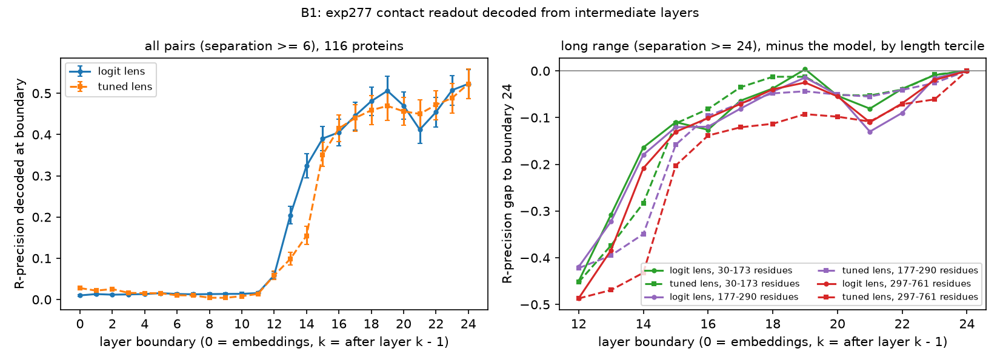

# exp341 B1: where exp277 computes contacts

B1 of [\#341](https://github.com/Open-Athena/MarinFold/issues/341) asks
where in exp277's 24 layers the contact prediction is computed, to inform
decision B in [`research_plan.md`](research_plan.md) (section 1.2): whether
the next size sweep should favour depth or width. Two measurements ran:
mean-ablating each layer's attention and MLP output, and decoding the
contact readout from every layer boundary with a logit lens and a tuned
lens. The pairwise probe in the sequence section (plan section 6.1) did not
run.

**Recommendation: do not make the next model shallower or move parameters
from depth into width. If a size sweep runs, run its deeper arm first,
and judge it on long proteins.** Both halves of the plan's "favour depth"
row hold, but the lens half holds narrowly: the last six layers add 0.042
R-precision under the logit lens, and the last five add 0.017, a gain that
grows with protein length. Neither
measurement shows that a deeper model would predict contacts better; only
the sweep can show that.

Decision B's depth rows. The plan numbers layers 1 to 24, so its "by layer
18" is boundary 18 here (the residual after 18 layers) and its "layers 19
to 24" are the change from boundary 18 to boundary 24 (the model):

| Plan's condition | "Favour depth" row | "Favour width or shallower" row | Observed |
|---|---|---|---|
| Mean-ablating one late layer (19 to 24) costs | >= 0.02 R-precision | < 0.01 | Every late MLP costs 0.054 to 0.458; late attention 0.001 to 0.281 |
| Lens readout from boundary 18 to 24 | still rising by >= 0.03 | within 0.01 of final by boundary 18 | Rises 0.042 (logit lens, CI 0.037 to 0.047) or 0.064 (tuned lens, 0.053 to 0.076) |

The plan proposed these thresholds before the run and treats them as
provisional. The ablation half does not depend on them (late MLP costs are
5 to 46 times the 0.01 boundary). The lens half does: a threshold of 0.05
instead of 0.03 would flip the logit-lens reading.

What the two measurements show together:

- **Contacts form in the second half of the network.** Neither lens decodes
  any contact signal through boundary 11 (all-pairs R-precision 0.004 to
  0.028, against 0.523 for the model). The logit lens then rises from 0.059
  at boundary 12 to 0.390 at 15 and 0.506 at 19. Layers 0 to 2 are still
  essential (ablating them costs 0.41 to 0.51), so the first half builds
  something the contact readout needs, but not in a form the unembedding
  can read at the query.
- **The last five layers add little on average and more on long
  proteins.** The logit lens at boundary 19 is 0.017 below the model (CI
  0.012 to 0.021), then dips to 0.412 at boundary 21 and recovers by 24.
  Layers 19 to 22 are among the costliest to ablate, so they change the
  representation heavily for a small net change in contact ranking. On
  long-range contacts the boundary-19 gap grows with length: -0.003,
  -0.014 and -0.025 by length tercile (logit lens), -0.013, -0.044 and
  -0.093 (tuned lens). Long proteins are where contacts-v1 scales worst
  (\#262, L^0.79), and B2 found the contact budget is not the cause (229 of
  69.5M training documents truncated).
- **A costly late layer shows the model uses its depth, not that it lacks
  depth.** A model with exactly enough layers and one that needs more would
  both show costly late layers; ablating layer 0 or 1 costs as much as
  layer 21, and that does not argue for more early layers. Layers 11 to 13
  each cost under 0.02 to ablate, and attention in layers 21 and 22 costs
  0.010 and 0.001, so some capacity is lightly used.
- **The tuned lens did not beat the logit lens.** The plan asks for this
  comparison to confirm the tuned lens adds information. Here it decodes
  less than the logit lens at boundaries 13 and 14 (0.098 and 0.155 against
  0.205 and 0.324) and at 19 to 23, despite explaining 90 to 95% of the
  held-out final residual's variance at boundaries 18 to 23. Its residual
  errors fall in the directions that rank contacts. The logit lens is the
  better reading of this model; the tuned lens's larger late rise (0.064)
  partly reflects its own error.

One cheap result would change the confidence of this recommendation before
any training: the same ablation and lens on an earlier exp277 checkpoint
(plan section 7.1). If the late layers' gain is still growing at the end of
training, the small average gain past boundary 19 reflects under-training,
not a ceiling.

## What ran

| Item | Value |
|---|---|
| Model | `contacts-v1-exp277-m2-p06-full-epoch-1.5B` (step 266344), bf16 |
| Proteins | 116: eval-val (97) and eval-denovo (19) |
| Readout | production pairwise P(contact), 4 document seeds per protein |
| Ablation | clean, plus 24 layers x {attention, MLP} each mean-ablated alone |
| Lens | logit and tuned lens at all 25 layer boundaries; tuned maps fitted on 200 legacy-554 proteins |
| Compute | one NVIDIA L4 (g6.xlarge, us-east-2): ablation 4.25 GPU-hours (about 320 s per condition); lens 5.5 min fit pass plus 6 min eval pass |
| Runs | ablation `s3://marinfold-exp91-usw2/exp341/b1/20261017T142617Z-9a5b6aa0/` (commit 9a5b6aa0); lens `s3://marinfold-exp91-usw2/exp341/lens/20261017T233643Z-6d7d0cee/` (commit 6d7d0cee) |

Mean ablation replaces the sublayer's output, before it is added to the
residual stream, with one fixed vector at every position. Each vector is
the mean of that sublayer's output over all 710,640 positions the clean
readout processes (sequence-section and contact-query positions, across all
proteins and seeds). The ablated runs reuse the clean run's proteins and
document seeds, so each comparison is paired.

R-precision is scored on the seed-averaged matrix, as in production, for
all pairs (separation >= 6) and three bands: short (6-11), medium (12-23)
and long (>= 24). The clean model scores 0.522 on all pairs (0.566 short,
0.537 medium, 0.498 long). An ablation that removes all contact signal
lands near -0.52.

## Layer ablation

Change in all-pairs R-precision (ablated minus clean), 116 proteins, 95%
bootstrap CI over proteins:

| Layer | Attention | MLP |
|---|---|---|
| 0 | -0.511 | -0.490 |
| 1 | -0.509 | -0.507 |
| 2 | -0.405 | -0.081 |
| 3 | -0.033 | -0.029 |
| 4 | -0.092 | -0.170 |
| 5 | -0.097 | -0.140 |
| 6 | -0.113 | -0.165 |
| 7 | -0.032 | -0.198 |
| 8 | -0.016 | -0.072 |
| 9 | -0.021 | -0.073 |
| 10 | -0.047 | -0.029 |
| 11 | -0.010 | -0.019 |
| 12 | -0.012 | -0.006 |
| 13 | -0.005 | -0.016 |
| 14 | -0.059 | -0.390 |
| 15 | -0.197 | -0.089 |
| 16 | -0.027 | -0.057 |
| 17 | -0.032 | -0.014 |
| 18 | -0.253 (-0.270, -0.236) | -0.325 (-0.350, -0.300) |
| 19 | -0.281 (-0.301, -0.261) | -0.054 (-0.062, -0.046) |
| 20 | -0.278 (-0.302, -0.254) | -0.337 (-0.362, -0.311) |
| 21 | -0.010 (-0.013, -0.007) | -0.458 (-0.490, -0.427) |
| 22 | -0.001 (-0.003, +0.002) | -0.372 (-0.404, -0.338) |
| 23 | -0.049 (-0.054, -0.043) | -0.104 (-0.114, -0.093) |

Layers 0 and 1 (both sublayers) and the layer 21 MLP leave almost no
contact signal. The costly sublayers fall in three groups: layers 0 to 2,
layers 14 and 15, and layers 18 to 22, with layers 11 to 13 the cheapest
stretch between them.

**Statistics.** 47 of the 48 conditions have a CI that excludes zero; the
exception is layer 22 attention. The median CI half-width is 0.010 when
bootstrapping proteins and 0.014 when also resampling the 4 document seeds
within each protein. The second CI is centred on the mean per-seed change,
which differs from the seed-averaged change by up to 0.09 (layer 15 MLP:
-0.182 per seed, -0.089 averaged), because R-precision of an averaged
matrix is not the average of per-seed R-precisions. Effects this large do
not need repeat runs; a run with `--seed-offset 4` would tighten the
seed-level CI if small effects become the question.

**Separation bands.** The four bands give similar changes for most
sublayers. The late MLPs are the exception: the layer 22 MLP costs 0.349 on
long-range pairs and 0.217 on short-range pairs, and the layer 21 MLP 0.432
against 0.351.

**Length.** Long-range change by length tercile (39, 38 and 39 proteins):

| Sublayer | 30-173 residues | 177-290 | 297-761 |
|---|---|---|---|
| Layer 18 MLP | -0.267 | -0.324 | -0.363 |
| Layer 20 MLP | -0.278 | -0.334 | -0.383 |
| Layer 21 MLP | -0.389 | -0.420 | -0.487 |
| Layer 22 MLP | -0.251 | -0.365 | -0.431 |
| Layer 23 MLP | -0.066 | -0.083 | -0.139 |
| Layer 19 attention | -0.224 | -0.273 | -0.324 |
| Layer 20 attention | -0.199 | -0.271 | -0.338 |

Clean long-range R-precision is similar across terciles (0.529, 0.452 and
0.512), so the growth is not an artefact of a higher starting
point on long proteins. Early layers show a weaker version of the same
trend (layer 6 MLP: -0.129, -0.173, -0.231).

**Eval set.** eval-denovo (clean 0.616) loses more than eval-val (clean
0.504) in absolute terms under every costly ablation (layer 21 MLP: -0.521
against -0.446), roughly in proportion to its higher starting score.

## Lens

The readout uses two next-token distributions over the protein's position
tokens: one at the `<contact>` query and one at each `<contact> <p_i>`
query. The lens takes the residual at those query positions at boundary k
(0 = embeddings, k = after layer k - 1) and decodes it:

- **Logit lens**: the model's final norm and unembedding applied directly.
- **Tuned lens**: one affine map per boundary first, fitted by ridge
  regression from the RMS-normalized boundary-k residual to the
  RMS-normalized final residual. The maps were fitted on 140,832 query
  residuals from the 200 legacy-554 proteins in `data/a2_legacy_gt.jsonl.gz`
  (4 seeds; no stem shared with the eval sets), with each boundary's ridge
  strength chosen on 20% of those proteins held out.

Both decodes run in float32. At boundary 24 both are the model; their
seed-averaged R-precision matches the production readout within 0.018 on
every protein (mean 0.5229 against 0.5223), the residual difference coming
from the production readout's bf16 logits.

All-pairs R-precision decoded at each boundary from 12 on (boundaries 0 to
11 are 0.004 to 0.028 under both lenses), with the gap to the model and its
paired bootstrap CI:

| Boundary | Logit lens | Gap (CI) | Tuned lens | Gap (CI) |
|---|---|---|---|---|
| 12 | 0.059 | -0.464 (-0.495, -0.432) | 0.058 | -0.465 (-0.497, -0.432) |
| 13 | 0.205 | -0.318 (-0.339, -0.296) | 0.098 | -0.424 (-0.454, -0.394) |
| 14 | 0.324 | -0.199 (-0.212, -0.185) | 0.155 | -0.368 (-0.395, -0.341) |
| 15 | 0.390 | -0.133 (-0.142, -0.123) | 0.351 | -0.172 (-0.187, -0.157) |
| 16 | 0.405 | -0.117 (-0.128, -0.107) | 0.415 | -0.108 (-0.119, -0.097) |
| 17 | 0.445 | -0.077 (-0.085, -0.070) | 0.440 | -0.083 (-0.094, -0.072) |
| 18 | 0.481 | -0.042 (-0.047, -0.037) | 0.459 | -0.064 (-0.076, -0.053) |
| 19 | 0.506 | -0.017 (-0.021, -0.012) | 0.469 | -0.053 (-0.063, -0.044) |
| 20 | 0.470 | -0.053 (-0.060, -0.046) | 0.456 | -0.067 (-0.077, -0.057) |
| 21 | 0.412 | -0.111 (-0.126, -0.097) | 0.450 | -0.073 (-0.085, -0.062) |
| 22 | 0.454 | -0.069 (-0.081, -0.057) | 0.472 | -0.051 (-0.060, -0.043) |
| 23 | 0.508 | -0.015 (-0.020, -0.011) | 0.489 | -0.034 (-0.043, -0.026) |
| 24 | 0.523 | 0 | 0.523 | 0 |

**Length.** Long-range gap to the model by length tercile:

| Lens, boundary | 30-173 residues | 177-290 | 297-761 |
|---|---|---|---|
| Logit, 18 | -0.038 | -0.044 | -0.039 |
| Logit, 19 | +0.003 | -0.014 | -0.025 |
| Logit, 21 | -0.081 | -0.130 | -0.110 |
| Tuned, 18 | -0.013 | -0.048 | -0.113 |
| Tuned, 19 | -0.013 | -0.044 | -0.093 |

Under the logit lens, short proteins' long-range contacts are fully
decodable by boundary 19, and the longest tercile's are 0.025 short of the
model. The tuned lens shows the same order with larger gaps.

**Eval set.** eval-denovo is ahead of eval-val at every boundary (logit
lens at boundary 19: 0.603 against 0.487; model 0.615 against 0.505), with
similar gaps to the model.

**Tuned-lens fit.** Held-out R² of the tuned map is 0.16 to 0.40 over
boundaries 0 to 11, 0.57 at 12, and 0.90 to 0.95 at 18 to 23. The
logit lens's R² against the same target is negative at every boundary (-1.43
at 0, -0.18 at 23): the raw intermediate residual is far from the final one
in Euclidean terms even where it already ranks contacts well. Chosen ridge
strengths range from 1e-4 to 1 times the mean feature variance.

## Limits

- **The mean mixes two kinds of position.** Each replacement vector
  averages sequence-section tokens with contact-query tokens. At a late
  layer those carry different signals, so a large cost can partly come from
  pushing the model off its usual inputs, not only from removing the
  sublayer's computation. Means taken over contact-query positions only, or
  resample ablation, would separate the two; neither was run.
- **One model, one checkpoint.** A layer profile of the final exp277
  checkpoint cannot distinguish converged late layers from late layers that
  are still learning; the plan's optional checkpoint trajectory (section
  7.1) is the test. It also cannot show how a 32- or 48-layer model would
  divide the same work.
- **Single-layer ablation misses shared work.** If two layers compute the
  same thing, removing either costs little. The cheap layers (11 to 13,
  late attention) are candidates for spare capacity, not proof of it.
- **The lens reads only the query positions.** Contact information held
  elsewhere (at the residues' sequence-section tokens) is invisible to it;
  that is what the pairwise probe in plan section 6.1 would measure, and it
  did not run. "No decodable signal through boundary 11" means none at the
  query, not none in the network.
- **The tuned lens is a least-squares fit on 200 proteins.** It explains
  most of the final residual's variance but decodes contacts worse than the
  logit lens. A lens trained on a KL objective over position tokens, as in
  the original tuned-lens work, might do better; this one was not tried.

## Files

- [`b1_layer_ablation.py`](b1_layer_ablation.py): the driver (per condition,
  per-seed P(contact) and banded R-precision; resumable).
- [`analyze_b1.py`](analyze_b1.py): paired deltas and both bootstrap CIs by
  band, eval set and length tercile.
- [`plot_b1.py`](plot_b1.py): the ablation figure.
- [`b1_tuned_lens.py`](b1_tuned_lens.py): the lens driver (fit, then decode
  every boundary; raw per-seed P(contact); resumable).
- [`analyze_b1_lens.py`](analyze_b1_lens.py), [`plot_b1_lens.py`](plot_b1_lens.py):
  lens curves with paired gaps by band, eval set and length tercile; the lens figure.
- [`data/b1_lens_curve.csv`](data/b1_lens_curve.csv),
  [`data/b1_lens_scores.csv`](data/b1_lens_scores.csv),
  [`data/b1_lens_fit.csv`](data/b1_lens_fit.csv),
  [`data/b1_lens_timings.csv`](data/b1_lens_timings.csv): curve, per-protein
  scores, tuned-map fit table, timings (with the boundary-24 check).
- [`plots/b1_lens.png`](plots/b1_lens.png).
- [`data/b1_deltas.csv`](data/b1_deltas.csv): every condition x band x split
  with both CIs.
- [`data/b1_scores.csv`](data/b1_scores.csv): R-precision per condition,
  protein and seed (and the seed-averaged matrix).
- [`data/b1_timings.csv`](data/b1_timings.csv): per-protein timings.
- [`plots/b1_layer_ablation.png`](plots/b1_layer_ablation.png).
- Not in git, under the S3 run prefixes above: the ablation's per-seed
  P(contact) for all 49 conditions (about 3.4 GB, `out/b1/pcontact/`), and
  the lens's per-seed P(contact) for both lenses at every boundary plus the
  fitted maps (`out/lens/pcontact/`, `out/lens/lens.npz`).
