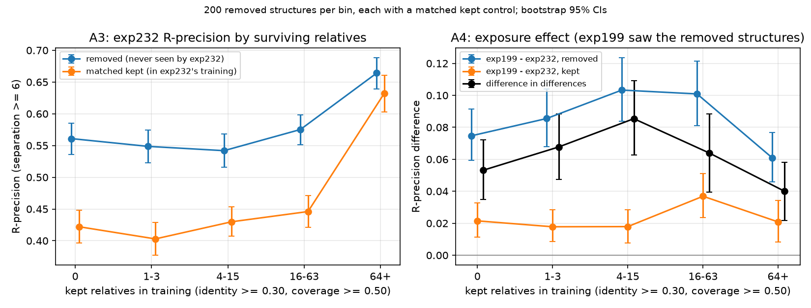
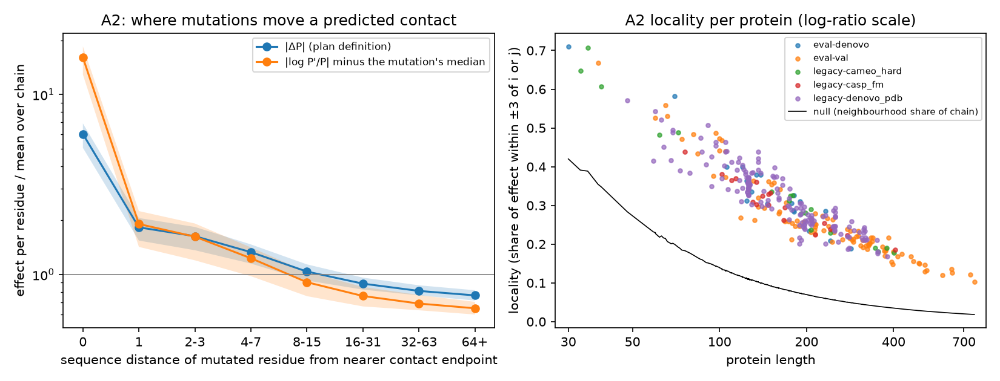
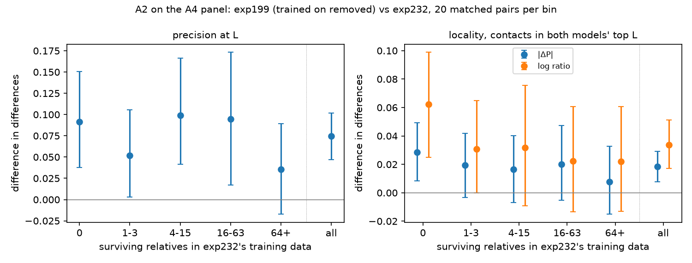

# exp341 Track A: memorization vs coevolution in contacts-v1

Track A of [\#341](https://github.com/Open-Athena/MarinFold/issues/341) asks
whether the next contacts-v1 model should cap how often each protein family
is sampled (decision A in [`research_plan.md`](research_plan.md), section 5).
A cap helps if the model recalls families and individual structures; it
costs accuracy if the model learns couplings from family statistics.

**Recommendation: no change to family weighting for the next model.** Keep
the corpus's current per-family sampling, and record decision A as
inconclusive. The plan fixed a rule for each outcome before any result
existed (section 1.2), and the results match neither row:

| Plan's condition | "Cap per cluster" row | "Keep redundancy" row | Observed |
|---|---|---|---|
| A4: exposure advantage with many relatives left | persists | | Persists: +0.040 R-precision at 64+ relatives |
| A3: accuracy vs surviving relatives | saturates at a small count | keeps rising | Flat from 0 relatives; control failed; breakpoint CI 2 to 435 |
| A2: contact dependence | non-local | local | Local, and exposure makes it more local |
| A1: coupling map tracks MSA depth | | yes | Not run |

The plan reports a result between the rows as inconclusive, and a cap needs
a value from A3 that the data do not give. The evidence behind this:

- **A4.** Training on a structure (together with its Foldseek cluster) adds
  0.04 to 0.085 R-precision in every relative-count bin, including
  structures that keep 64 or more relatives in training. That is a memorized
  component, small next to the 0.56 R-precision exp232 reaches on the same
  structures without seeing them.
- **A3.** Its accuracy curve is flat from zero relatives, and its control
  set scores below the structures it was meant to bound, so it supplies no
  cap value.
- **A2.** Locality cannot separate recall from coupling in this model:
  exposure made each contact depend more on the residues at the contact, not
  less, which is the direction the plan assigned to coupling.

Two things would reopen the decision: an A3 control matched on whatever
makes removed structures easier (no new GPU training needed), or a
per-cluster cap ablation in training. Further A2 work (the fp32 rerun of the
eval set) would not, since locality cannot decide A.

## What ran

| Part | Model | Proteins | Readout | State |
|---|---|---|---|---|
| A4 | exp199 vs exp232 | 1,000 removed + 1,000 matched kept | R-precision, 4 seeds | Done |
| A3 | exp232 | same panel | R-precision, 4 seeds | Done; control failed |
| A2, eval set | exp277 | 316 (eval-val, eval-denovo, 200 legacy-554) | contact Jacobian, bf16, 1 seed | Done; bf16-limited |
| A2, A4 panel | exp199 and exp232 | 100 matched pairs, both members <= 250 residues | contact Jacobian, fp32, 1 seed | Done |
| A1 | | | sequence-section Jacobian | Not run |

Models: `contacts-v1-exp199-cooldown-1.5B` (step 290400) trained on the
structures \#225 later removed; `contacts-v1-exp232-m2-p06-train-1.5B` (step
363000) never saw them; `contacts-v1-exp277-m2-p06-full-epoch-1.5B` is the
registry default. All runs used one L40S (g6e.xlarge, us-east-2). The panel
readouts took 1.39 h per model, A2 on the eval set 18.2 GPU-h, and A2 on the
panel 20.9 GPU-h.

## The held-out panel

\#225 removed 166,679 AFDB structures (4.04% of the corpus) because they
resembled eval proteins. From 300 of the 2,067 AFDB shards we took 23,745
removed and 12,000 kept candidates, counted each one's relatives in exp232's
69.5M training sequences (MMseqs2, identity >= 0.30, coverage >= 0.50), and
selected 200 removed structures per bin (0, 1-3, 4-15, 16-63, 64+
relatives), each matched one-to-one to a kept structure from the same bin on
length, pLDDT and relative count (every standardized mean difference <=
0.08). Ground truth is each structure's own contacts-v1 document. Matching
is within bin only: median removed length falls from 540 in bin 0 to 138 in
64+, and median pLDDT rises from 78.5 to 90.1, so bins are not comparable to
each other. Details and paths are in [`README.md`](README.md).

## A4: exposure adds accuracy in every bin

Difference in differences: (exp199 − exp232 on removed) − (exp199 − exp232
on kept). The kept term absorbs how the two models differ overall. CIs
bootstrap pairs within bin (10,000 resamples).

| Relatives | exp199 − exp232, removed | exp199 − exp232, kept | DiD [95% CI] |
|---|---|---|---|
| 0 | 0.075 | 0.021 | 0.053 [0.035, 0.072] |
| 1-3 | 0.086 | 0.018 | 0.068 [0.047, 0.089] |
| 4-15 | 0.103 | 0.018 | 0.085 [0.063, 0.109] |
| 16-63 | 0.101 | 0.037 | 0.064 [0.040, 0.088] |
| 64+ | 0.061 | 0.021 | 0.040 [0.022, 0.058] |

Surviving relatives do not substitute for exposure: the effect at 64+ is
smaller but still excludes zero. \#225 purged whole clusters, so this
measures exposure to a structure and its removed relatives, about 16 AFDB
epochs of them. For scale, exp199's promotion over exp166 was +0.026, and
\#245 could not resolve the same model comparison on eval proteins (+0.024
[−0.022, +0.073]).

## A3: no dose-response, and the control is not a ceiling

exp232 R-precision on removed structures it never saw:

| Relatives | Removed | Matched kept | Removed − kept [95% CI] |
|---|---|---|---|
| 0 | 0.561 | 0.422 | 0.139 [0.104, 0.173] |
| 1-3 | 0.549 | 0.403 | 0.146 [0.108, 0.183] |
| 4-15 | 0.542 | 0.430 | 0.112 [0.077, 0.147] |
| 16-63 | 0.575 | 0.446 | 0.129 [0.094, 0.165] |
| 64+ | 0.664 | 0.632 | 0.032 [−0.002, 0.066] |

Structures with no surviving relatives score as well as those with 16-63.
The rise at 64+ also appears in the kept controls, where proteins are much
shorter. A piecewise-linear fit puts the saturation breakpoint at 7
relatives with a bootstrap CI of 2 to 435, so the curve gives no cap value.

The plan used kept structures as each bin's ceiling, but exp232 scores
removed structures it never saw 0.11 to 0.15 above kept structures it
trained on. Two explanations were tested and failed
([`data/removed_gap_checks.json`](data/removed_gap_checks.json)). Similarity
to eval proteins goes the wrong way: R-precision falls from 0.609 to 0.541
between the lowest and highest quartiles of identity to the nearest eval
reference. Contact density and long-range share account for 0.009 of the
0.112 mean gap. The gap is unexplained, and until it is, the kept set is not
a counterfactual for the removed set.

## A2: the contact Jacobian

For every residue k and four substitutions (Ala, Gly, Pro, a charge flip),
the production pairwise readout is rerun and the change in P(contact) is
recorded for the protein's top-L predicted contacts (separation >= 6).
P(contact) is the probability that {i, j} is the next contact statement, so
it sums to about 1 over pairs; top-L values are around 0.004. Per contact:

- **Locality**: the share of Σ|ΔP| from mutations within ±3 of i or j. The
  null, |N(i) ∪ N(j)| / L, is the share a mutation effect spread evenly over
  the chain would give.
- **Log scale**: the same share computed on |log(P′/P) − m|, where m is the
  mutation's median log ratio over the top-L contacts. Subtracting m removes
  the shift every contact takes when renormalization moves probability
  elsewhere. P′ is floored at 1e-5: knockouts at a contact's own residues
  overshoot to P′ as low as −1.1e-5 in fp32, and without a floor those
  strongest effects became NaN and were dropped.
- **Structural share**: the share from true-contact partners of i or j
  outside the ±3 window.

### Eval set (exp277, bf16)

Across 316 proteins, locality is 0.193 [0.185, 0.202] against a null of
0.091 (log scale 0.302 [0.291, 0.314]). Per residue, a mutation at i or j
itself moves the contact 6.0 times as much as the chain average (15.7 times
on the log scale), the ±1 neighbours 1.8 times, and residues 64 or more
away 0.77 times. The structural share, 0.028, barely exceeds its null of
0.023: mutating a residue that touches i or j in the structure moves the
contact little more than mutating any other residue. Correct and incorrect
predicted contacts have the same locality (difference 0.002 [0.000,
0.004]). The 37 novel-fold proteins with no training homolog sit at 0.189,
the same as the rest.

These numbers are lower bounds. On 9 proteins of length 70 to 130 rerun in
fp32, locality averaged 0.374 against 0.278 in bf16. Far from the contact,
the bf16-minus-fp32 difference in ΔP has a median 0.6 to 5.2 times the
median fp32 ΔP itself, depending on the protein. Because that error varies
by protein, the covariate regression on this run is not interpretable: any
coefficient, including length (−0.90 on logit locality), can absorb it, and
the precision coefficient flips sign between scales (−0.049 raw, +0.317
log). An fp32
rerun of the 316 proteins would cost about 33 L40S-h; it has not been run.

### A4 panel (exp199 vs exp232, fp32)

The plan's test for recall: if exp199's advantage on the structures it
trained on comes with a less local Jacobian than exp232's, while the kept
controls show no difference, the advantage is recall. The subset is 20
matched pairs per bin with both members at most 250 residues (bin 0 has
exactly 20 such pairs, well below its median length of 546), run in fp32.

| Metric | exp199 − exp232, removed | exp199 − exp232, kept | DiD [95% CI] |
|---|---|---|---|
| Precision at L | 0.080 | 0.005 | 0.075 [0.047, 0.102] |
| Locality, raw | 0.016 | 0.001 | 0.015 [0.005, 0.024] |
| Locality, log | 0.025 | −0.003 | 0.028 [0.014, 0.044] |
| Locality on shared contacts, raw | 0.020 | 0.001 | 0.018 [0.008, 0.029] |
| Locality on shared contacts, log | 0.031 | −0.003 | 0.034 [0.017, 0.051] |
| Structural share, raw | 0.002 | −0.001 | 0.003 [0.001, 0.004] |

Exposure raised precision at L, reproducing A4 on this subset, and raised
locality instead of lowering it. "Shared contacts" restricts both models to
contacts in both of their top-L sets, so the increase is a change in how
exp199 computes the same contacts, not in which contacts it predicts. Per bin, every locality DiD is positive;
with 20 pairs, only bin 0 excludes zero on its own. In fp32 the structural
share is 1.4 to 1.9 times its null (0.031 to 0.036 against 0.019 to 0.023),
and exposure moves it by 0.003.

Locality and precision move together. In a check outside the committed
outputs, their Spearman correlation across the 400 structure-model rows is
0.53 (log scale), and the 23 pairs whose precision DiD is under 0.02 in
magnitude have a locality DiD of 0.001. The data do not say whether exposure sharpens
locality directly or whether locality follows from a more confident
prediction.

## What this means for decision A

The plan read high locality as coevolution-like coupling and dependence
spread over the chain as recall. In exp199, training on a structure moved
dependence toward the contact's own residues. One reading that fits, not
tested here, is memorization of local sequence at both endpoints (the
motif-pair hypothesis in Zhang et al. 2024): a ±3 window cannot tell that
apart from coupling. Either way, a high locality on the eval set does not
show the model avoids recall, and the locality-at-matched-MSA-depth test in
section 5.2 cannot decide A.

That leaves A4 as the evidence. exp199 carries a memorized component worth
0.04 to 0.085 R-precision on structures it trained on for about 16 epochs,
present at every relative count. A per-cluster cap would remove some of
that; the panel does not say what the cap should be or what it would cost
on unseen proteins, because A3 has no working control and its curve is flat.
A cap ablation in training, or an A3 control matched on whatever makes
removed structures easier, would supply the number.

## Limits

- The eval-set A2 run and the panel A2 run use different models (exp277 vs
  exp199/exp232) and precisions (bf16 vs fp32). Their absolute localities
  are not comparable.
- A2 used one seed per protein; the R-precision readouts used four.
- The panel A2 subset is the short tail of each bin, and its precision is
  precision at L, not R-precision.
- exp199 and exp232 differ in training length and schedule as well as
  corpus; the kept-set term removes overall differences, not interactions
  between schedule and protein type.
- Not run: A1 (needs a gradient path through the readout), the A4
  document-level "seen vs fresh offset" variant, harness checks 3 and 4, and
  the fp32 rerun of the eval-set A2.

## Files

| Data | Script |
|---|---|
| [`data/contamination_did.csv`](data/contamination_did.csv), [`data/relative_dose_response.csv`](data/relative_dose_response.csv), [`data/relative_dose_fit.json`](data/relative_dose_fit.json), [`data/panel_scores/`](data/panel_scores/) | [`analyze_panel.py`](analyze_panel.py), [`plot_panel.py`](plot_panel.py) |
| [`data/a2_per_protein.csv`](data/a2_per_protein.csv), [`data/a2_distance_profile.csv`](data/a2_distance_profile.csv), [`data/a2_summary.json`](data/a2_summary.json), [`data/a2_precision_check.json`](data/a2_precision_check.json), [`data/a2_timings.csv`](data/a2_timings.csv) | [`a2_contact_jacobian.py`](a2_contact_jacobian.py), [`analyze_a2.py`](analyze_a2.py), [`plot_a2.py`](plot_a2.py) |
| [`data/a2_panel_proteins.csv`](data/a2_panel_proteins.csv), [`data/a2_panel_per_structure.csv`](data/a2_panel_per_structure.csv), [`data/a2_panel_did.csv`](data/a2_panel_did.csv) | [`a2_panel_select.py`](a2_panel_select.py), [`analyze_a2_panel.py`](analyze_a2_panel.py), [`plot_a2_panel.py`](plot_a2_panel.py) |

Raw outputs: `s3://marinfold-exp91-usw2/exp341/` (`panel/`, `a2/`,
`relatives/`).
